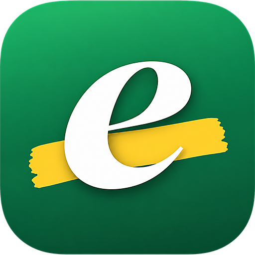

<p align="center"></p>

<h1 align="center">Essay Builder</h1>

<p align="center"><b>Write your essay on real pages. Get a perfect PDF.</b><br>
The cover, contents page, page numbers and word count are all done for you.</p>

Made for IB students, but it works for any long piece of writing. It comes with ready-made templates, each with its own checklist from the IB criteria:

- **Core:** Extended Essay, TOK essay, TOK exhibition, CAS reflection, CAS project
- **Subjects:** Science IA (Biology, Chemistry, Physics), Maths IA (AA and AI), Computer Science IA, Business Management IA, Digital Society IA, History IA
- **Languages:** English essay, English Individual Oral, French and Arabic writing tasks

## Get it

### Windows 10 / 11

Download `EssayBuilder-Setup.exe` from [Releases](../../releases), run it, and you're done. 🎉

If Windows says "Windows protected your PC", press **More info**, then **Run anyway**. It shows this because the app is new and not signed yet. After that, Essay Builder updates itself.

### Mac / Linux

Open Terminal, paste this line and press Enter:

```
curl -fsSL https://raw.githubusercontent.com/VNyMay/EssayBuilder/main/install.sh | bash
```

That's it. It downloads everything else it needs by itself. If Google Chrome isn't installed yet, it shows the one command that installs it (or offers to run it for you), waits until Chrome is there, then carries on. It adds **Essay Builder** to your Applications (Mac) or apps menu (Linux), with an icon on your Desktop. The first start takes a few minutes; after that it opens in seconds. Run the same line again any time to update.

<details>
<summary>Other ways to run it</summary>

**From a downloaded copy:** run `bash install.sh` inside the folder.

**Docker:** run `docker compose up -d` in the folder, then open http://localhost:8787.

**By hand:** with Python 3.10+, Node.js 18+ and Chrome or Edge installed, run `python3 studio/serve.py`.
</details>

## First steps

The first time you open Essay Builder, it asks what you're writing and opens the right template. A few things worth knowing:

- **Write and Preview:** the switch at the bottom right. Write lets you type on the real pages; Preview shows the finished PDF. Double-click in Preview to jump back to that spot.
- **Add** (or type **/**) inserts tables, charts, equations, citations, footnotes and lots more. Type **@** to cite a source or point to a figure.
- **Point between two blocks** and press **+** to add something exactly there.
- **Check** goes through your essay against the IB criteria and finds mistakes.
- **Charts** can show error bars and a line of best fit for science IAs.
- **Ctrl+K** finds any action, so you never have to hunt through menus.
- **Export PDF** saves your finished essay wherever you like.
- **Back up for free:** keep your essays in OneDrive, Google Drive or Dropbox from the home screen.

## Stuck? Ask an AI 🤖

Upload the file `AI Prompt.txt` to any AI chat (ChatGPT, Claude, Gemini…) and ask it anything about Essay Builder. It knows every feature, so it can explain how something works, or even turn your notes into a ready-to-open essay file for you.

## Licence

MIT, see [LICENSE](LICENSE). The open source parts we use are listed in [THIRD_PARTY_NOTICES.md](THIRD_PARTY_NOTICES.md).
